# SIEM Home Lab

A small home lab where I set up Wazuh (an open-source SIEM/XDR platform), connected it to a Windows machine, and simulated both local and network-based failed login attempts to practice detecting and analyzing security events ,which is basically what a SOC analyst spends their day doing.

## Background

I have about a year of experience in IT Support and I'm currently moving toward a career in cybersecurity (completing the Google Cybersecurity Professional Certificate). I built this lab to get hands-on experience with a real SIEM tool instead of just reading about how one works.

## Lab Architecture

The lab has three machines, all on the same local network:

- **Wazuh Server** (192.168.1.12) — Linux VM running Wazuh. This is the SIEM, it collects and analyzes logs from the other machines.
- **Windows PC** (192.168.1.3) — my own Windows 11 machine, set up as the monitored endpoint (the "victim").
- **Parrot OS** (192.168.1.13) — a Linux VM playing the role of the attacker.

All three are on the same network (VirtualBox, Bridged mode), so the Wazuh server sees activity from Parrot the same way it would see traffic from any other device on a real network.

## Part 1 — Setup & Local Login Testing

### Setting up the Wazuh server

I downloaded the official Wazuh OVA and imported it into VirtualBox. It already comes with the three main Wazuh components installed: the server (analyzes logs and creates alerts), the indexer (stores the alerts), and the dashboard (the web interface I used to see everything).

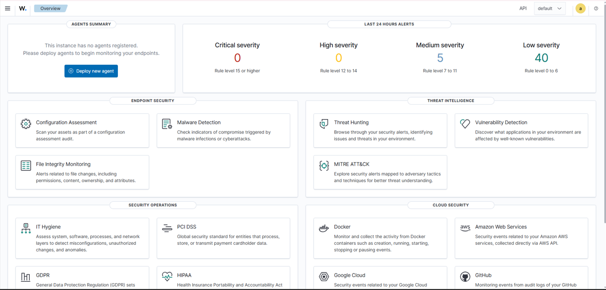

### Problem: the disk filled up

The default disk on the OVA is 25GB. Not long after starting the VM, the dashboard started showing errors saying the disk usage had exceeded a safety threshold  and new data couldnt be written.


I ran `df -h` and saw the disk was at 100% (25G used, only 39M free). Turns out the indexer blocks writing to disk once it gets too full, as a safety measure, which is why the dashboard couldn't set up its index patterns.

To fix it:
1. Shut down the VM and resized the virtual disk from 25GB to 50GB in VirtualBox.
2. Grew the partition inside the VM: `sudo growpart /dev/sda 1`
3. Grew the filesystem: `sudo xfs_growfs /`
4. Rebooted the VM.

After that, `df -h /` showed the disk at 31% usage, and the dashboard loaded fine.

### Installing the Windows agent

From the dashboard, I used "Deploy new agent" to get a PowerShell command for installing the agent on my Windows PC, pointing it to the Wazuh server (192.168.1.12). After running it, I started the service:

```powershell
NET START Wazuh
```

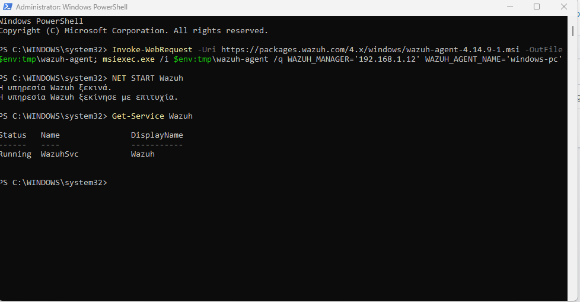

At first the agent showed up as **Pending**:

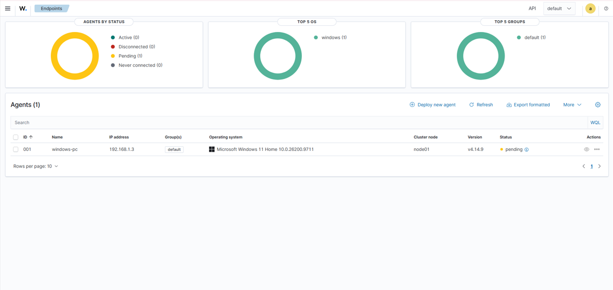

A minute or two later, it switched to **Active** and started sending data (system info, a CIS security benchmark scan, etc.).

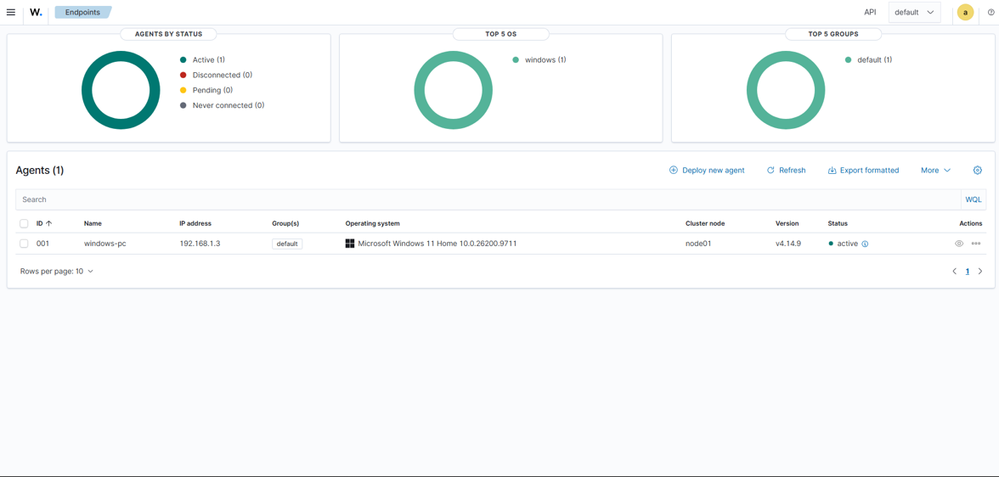

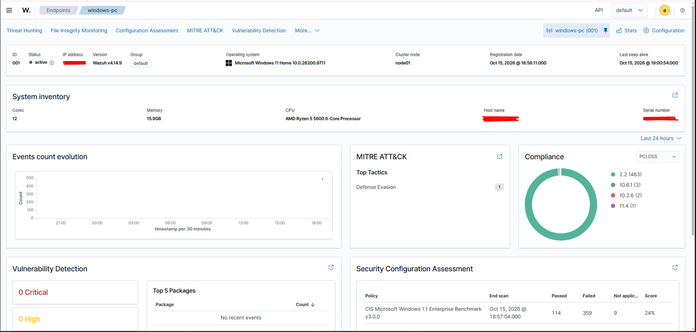

### Analyzing the first failed login (local)

To generate a test event, I locked my Windows screen and entered the wrong PIN a few times before logging in normally. A minute later, I found the matching alert in Wazuh under **Threat Hunting → Events**:

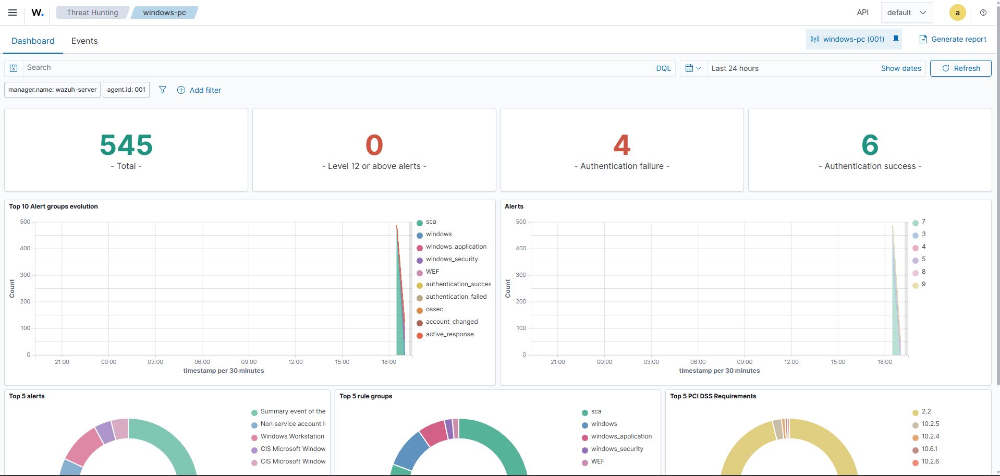

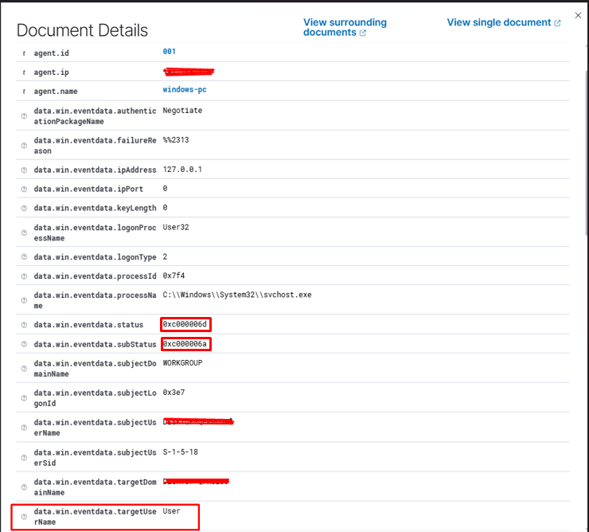

Key fields in the event:

- `rule.description`: Logon Failure - Unknown user or bad password
- `data.win.eventdata.logonType`: 2 (Interactive — typed directly on the machine)
- `data.win.eventdata.ipAddress`: 127.0.0.1 (localhost, confirming it wasn't a network login)
- `data.win.eventdata.status`: 0xC000006D
- `data.win.eventdata.subStatus`: 0xC000006A

I wasn't sure exactly what the status/subStatus codes meant, so I looked them up in Microsoft's documentation for Windows event 4625:

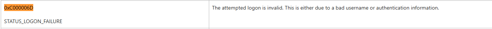
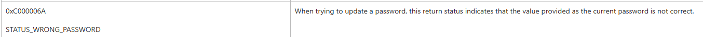

- `0xC000006D` = **STATUS_LOGON_FAILURE** — a general logon failure.
- `0xC000006A` = **STATUS_WRONG_PASSWORD** — the account exists, but the password was wrong.

Since the target account (`targetUserName`) matched my own local account, this confirmed the event was exactly what I expected: a harmless, self-caused failed login — not something to escalate. But it also showed me what a legitimate SOC analyst workflow looks like: don't just read the alert description, check the account, the source, the logon type, and verify anything you're not 100% sure about.

## Part 2 — Network Attack Simulation (SSH)

The first test was local (logon type 2, from 127.0.0.1). To see what a *network-based* failed login looks like, I set up a second scenario using the Parrot OS VM as an "attacker" trying to log in to my Windows PC over the network.

### Setting up the network

Parrot was initially set to NAT mode in VirtualBox, which gave it an internal-only address (10.0.2.15) that couldn’t talk to the other machines. Switched it to Bridged mode instead, same as the Wazuh server, and it picked up a real address on the network.

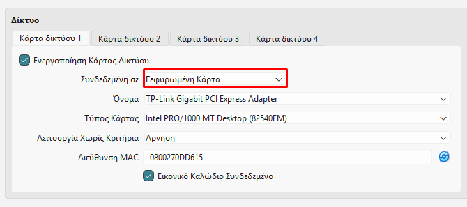

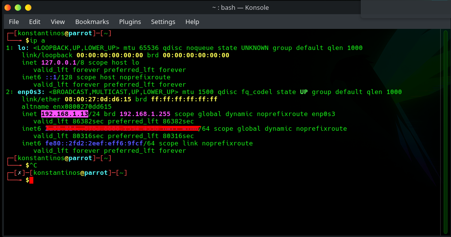

### Enabling SSH on Windows (temporarily)

Windows 11 Home doesn't support an RDP server, so I used OpenSSH Server instead, which is available as an optional Windows feature. I enabled it just for this test:

```powershell
Add-WindowsCapability -Online -Name OpenSSH.Server~~~~0.0.1.0
Start-Service sshd
```

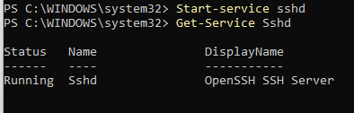

The Windows Firewall already had an inbound rule for it, scoped to the **Private** network profile only:

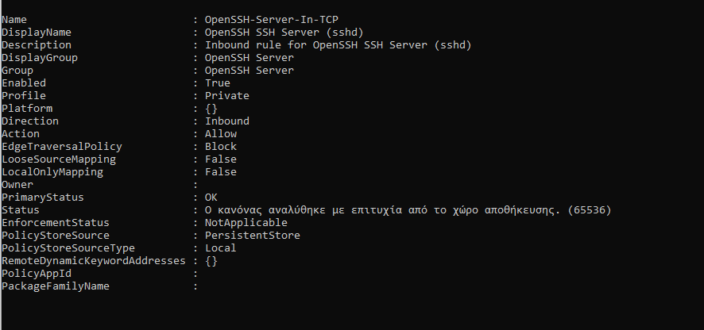

My network adapter was set to "Public" in Windows, which silently blocked the connection at first (an RDP test earlier also timed out for the same reason). I switched it to "Private":

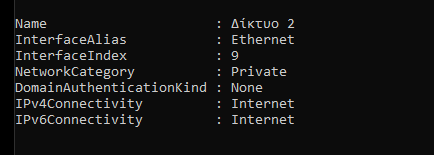

### Running the test

From Parrot, I tried to SSH into my Windows account with the wrong password, three times:

```bash
ssh -o ConnectTimeout=5 User@192.168.1.3
```

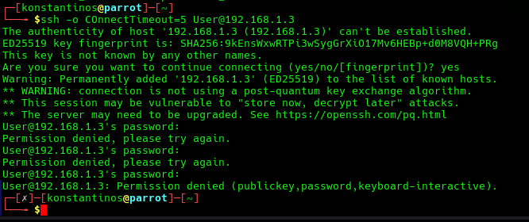

### Analyzing the network-based failed login

Back in Wazuh, I found the matching events — three more "Logon Failure" alerts, generated at the same time as the SSH attempts:

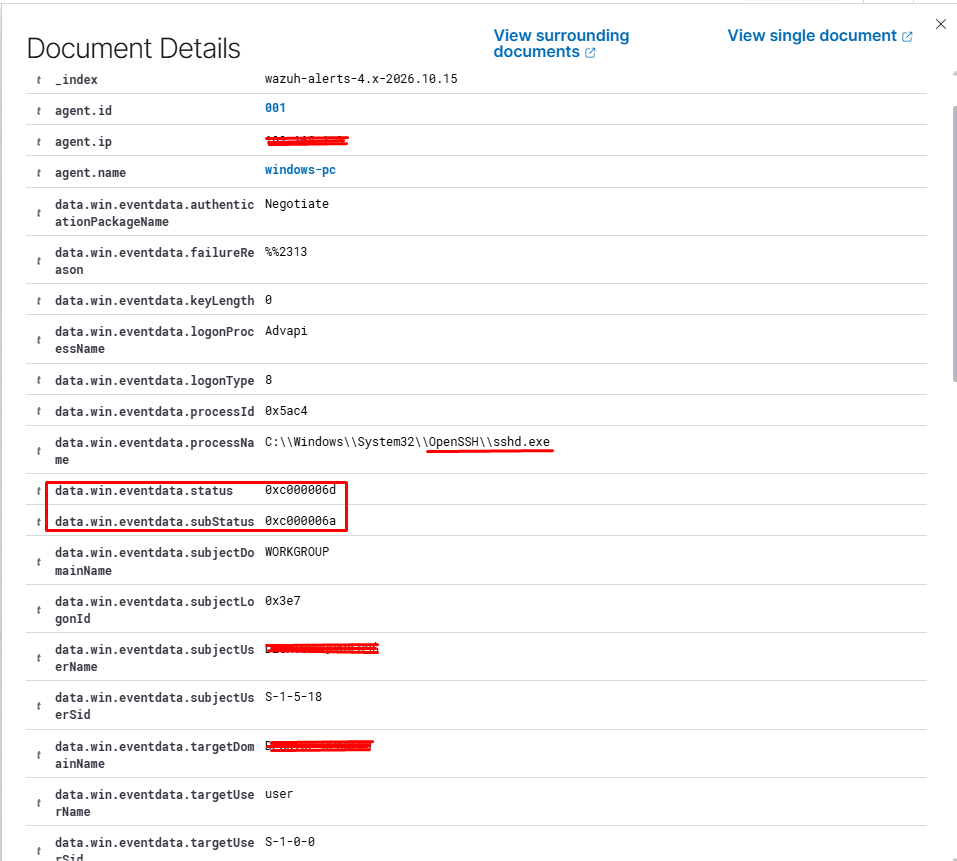

This time, the key fields were different:

- `data.win.eventdata.logonType`: 8 (NetworkCleartext, used by SSH password auth)
- `data.win.eventdata.processName`: `C:\Windows\System32\OpenSSH\sshd.exe` — confirming the login attempt came through the SSH service, not the normal Windows logon screen
- `data.win.eventdata.status` / `subStatus`: the same 0xC000006D / 0xC000006A as before (wrong password)

One thing I noticed: the `ipAddress` field was empty this time, unlike the local test. It looks like Windows doesn't always populate that field correctly for SSH logons — the `workstationName` field also just showed my own PC's name instead of Parrot's.

To confirm the real source IP, I checked OpenSSH's own logs instead:

```powershell
Get-WinEvent -LogName "OpenSSH/Operational" -MaxEvents 20
```

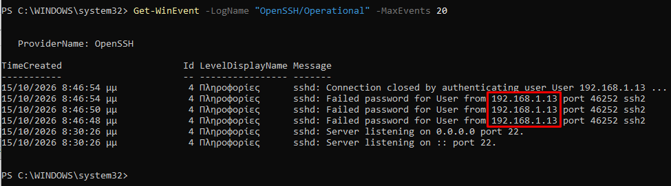

This showed exactly what I needed: `sshd: Failed password for User from 192.168.1.13 port 46252 ssh2`, repeated three times, matching the attempts from Parrot. Good lesson: dont trust one log source completely, if a field is missing, check somewhere else.

### Cleaning up

Once I was done testing, I stopped and disabled the SSH service so it wouldn't stay exposed:

```powershell
Stop-Service sshd
Set-Service sshd -StartupType Disabled
```

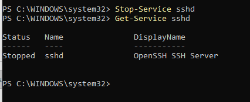

## What I Learned

- I actually get now how a SIEM works end to end (agent → server → indexer → dashboard), not just the theory of it. And reading an alert properly means actually checking the account, the source, the logon type — not just glancing at the description and moving on.
- The disk filling up was annoying but honestly the most useful part. 25GB sounds like plenty until you watch it hit 100% in like an hour.
- NAT vs Bridged, Public vs Private network profiles, these are the kind of settings nobody tells you about until something just... doesn't connect, and you spend way too long figuring out why.
- Biggest one: logs don't always tell you everything. The Windows event was missing the attacker's IP, but the OpenSSH log had it. Lesson learned — if something's not in one place, check somewhere else first.

## Tools Used

- [Wazuh](https://wazuh.com/) (SIEM/XDR)
- VirtualBox
- Windows 11, PowerShell, OpenSSH Server
- Parrot OS
